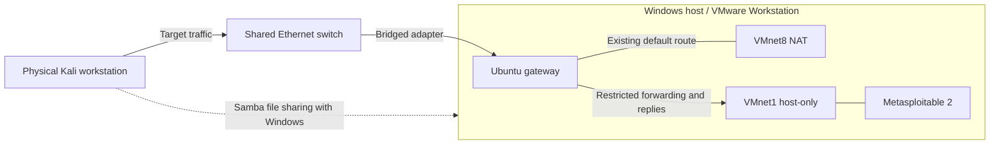

# My penetration-testing lab

I prepared this lab for my 7 Tools in 7 Days challenge so I could practice against an intentionally vulnerable target in a controlled environment. The infrastructure supports the tool investigations tracked in the [progress log](../PROGRESS.md).

## How the machines connect

My dedicated physical Kali Linux PC is the testing workstation. My Windows 11 PC runs VMware Workstation, with Metasploitable 2 as the target and an Ubuntu VM as the restricted gateway. Windows and Kali connect through an unmanaged Ethernet switch.

Ubuntu has three adapters: VMware NAT for its existing default route, VMnet1 host-only for the target, and a bridged adapter for Kali to reach the gateway. Metasploitable uses only the host-only network.

The diagram shows logical connections, not unrestricted access.

VMnet1 also connects to the Windows host. Traffic directly between devices on that subnet does not pass through Ubuntu's firewall.

## Routing and restrictions

A persistent NetworkManager route on Kali sends only the target's address through Ubuntu. Kali's default route stays unchanged. Narrow source NAT on Ubuntu lets the target reply without needing a default route of its own.

The gateway configuration combines a separate nftables guard with a specific UFW routed permission. It permits Kali-initiated target traffic and established replies, and drops other forwarding through the lab and bridged interfaces. Incoming traffic to Ubuntu's bridged interface is blocked except DHCP replies. Existing Docker firewall rules were preserved.

Configuration backups and targeted rollback scripts are stored privately. The setup uses saved network profiles, a boot-time guard service, and a persistent IPv4 forwarding setting.

## File sharing

A persistent Samba share connects Windows and Kali, appearing as a mapped drive on Windows. I use it for lab notes and private raw evidence. Only selected, reviewed, sanitized copies belong in this repository.

## Troubleshooting and lessons

I ran the prepared setup scripts and used command output, connection tests, and packet captures to check the results.

- **Physical-to-virtual connectivity:** Kali could not directly reach the host-only target. The Ubuntu gateway and target-specific route provided that path without bridging the vulnerable VM onto the home network.
- **Firewall ordering:** The new bridged adapter stayed disconnected until its restrictions were loaded. Forwarding was off initially but on after reboot; Docker was a possible cause, not a confirmed one. This showed why isolation needed explicit firewall rules rather than relying on forwarding staying disabled.
- **A failed ping wasn't enough:** The first counter reading did not establish a firewall drop. A repeated probe, packet capture, and fresh counter reading showed where the traffic stopped.

The main lesson for me was to verify the route, packet arrival, and firewall decision separately.

## What was verified

| Check | Observed result |
| --- | --- |
| Ubuntu and Kali to target SSH | TCP/22 connections succeeded |
| Gateway SSH from Kali | Connection timed out |
| Gateway SSH, HTTP, and HTTPS from Windows | Connections timed out |
| Ubuntu and Kali reboot | Saved target route and target SSH still worked; gateway SSH still timed out |
| Target-initiated probe toward Windows through Ubuntu | Three requests reached the lab interface; the guard recorded three drops totaling 252 bytes |
| Windows mapped share | Remained accessible during setup |

The isolation probe used a temporary target route that was removed afterward.

## Limits

These tests verify specific paths, not every protocol or possible bypass. Another home device attempting to reach the target through Ubuntu was not directly tested. Source-address filtering is not authentication and does not prevent address spoofing. The unmanaged switch provides no VLAN isolation, and direct VMnet1 traffic bypasses the gateway.

Target-initiated reverse shells are blocked by the current policy. DHCP reservations are unavailable to me, so address changes may require route and rule updates. I will check the addresses before lab sessions. Real addresses, account details, and full firewall configurations are kept outside this repository.
